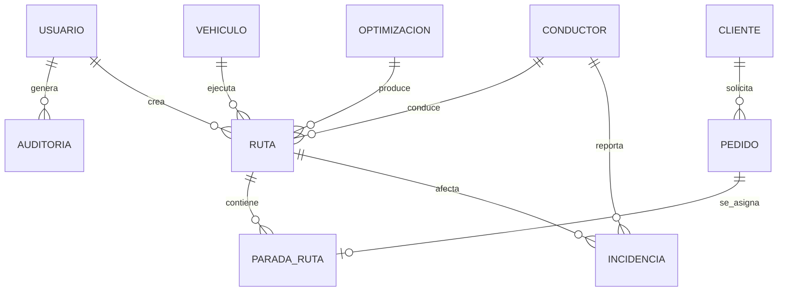
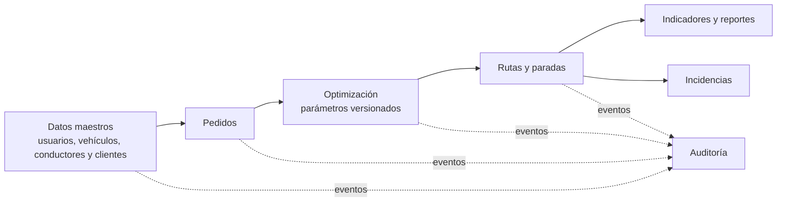

# Diseño e ingeniería de base de datos

- [Volver ->](<../../README.md>)

| Metadato | Valor |
|---|---|
| Proyecto | EcoLogística Lima |
| Versión | 1.1.0 |
| Fecha | 25/10/2026 |

## Modelo conceptual



El modelo conceptual es el diseño objetivo. La relación RUTA–INCIDENCIA se
implementará cuando exista el modelo de rutas; desde la versión 1.1.0, la
incidencia implementada se vincula al conductor que la reporta y, de forma
opcional, a una parada de su itinerario (ver modelo lógico).

## Modelo lógico (3FN)

| Entidad | Atributos principales | Claves y propósito |
|---|---|---|
| usuario | usuario_id, email, password_hash, rol, estado, debe_cambiar_contrasena, contrasena_temporal_expira_en | PK usuario_id; email único; acceso. Los dos últimos atributos soportan el restablecimiento con contraseña temporal (ECL-77). |
| vehiculo | vehiculo_id, placa, tipo, capacidad_kg, capacidad_m3, rendimiento_km_l, factor_co2, anio, estado | PK; placa única; recursos de ruta. |
| conductor | conductor_id, usuario_id, dni, licencia, experiencia_anios, telefono, disponible_desde/hasta, punto_partida | PK; FK usuario; datos mínimos del conductor. |
| cliente | cliente_id, nombre, horario_preferido, referencia, restriccion_acceso | PK; preferencias de entrega. |
| pedido | pedido_id, cliente_id, direccion, ubicacion, peso_kg, volumen_m3, ventana_inicio/fin, prioridad, tipo_producto, estado | PK; FK cliente; ubicación PostGIS. |
| optimizacion | optimizacion_id, solicitada_por, estado, parametros_version, inicio/fin, objetivo | PK; FK usuario; ejecución reproducible. |
| ruta | ruta_id, optimizacion_id, vehiculo_id, conductor_id, distancia_km, tiempo_min, co2_kg, costo, estado | PK; FKs; resultado por recurso. |
| parada_ruta | parada_id, ruta_id, pedido_id, secuencia, eta, atendida_en, estado | PK; FKs; pedido asignado una vez por ruta. |
| incidencia | incidencia_id, conductor_id, parada_id, operation_id, tipo, severidad, ubicacion, ocurrida_en, registrada_en, observacion, estado | PK; FK conductor (quien la reporta); FK opcional a la parada asignada al conductor; operation_id único para la idempotencia de la cola offline. Estado inicial PENDIENTE_VALIDACION (ECL-73). |
| parametro | parametro_id, codigo, valor, unidad, vigente_desde/hasta, fuente | PK; parámetros versionados. |
| auditoria | auditoria_id, usuario_id, entidad, entidad_id, accion, creado_en, detalle | PK; FK usuario; trazabilidad. |

Las entidades no repetitivas se mantienen en 3FN: preferencias pertenecen a cliente, las paradas resuelven la relación ruta-pedido y los parámetros conservan su vigencia. Los DNI y teléfonos requieren acceso restringido y nunca se exportan sin autorización.

**Incidencia sin `ruta_id` (ECL-73).** El modelo de rutas (`ruta` y
`parada_ruta`) todavía no existe, así que la incidencia implementada no tiene
`ruta_id`: el conductor reportante sustituye a `reportada_por`, y `parada_id`
apunta a la asignación de parada del conductor (`driver_stop_assignment`, la
tabla que hoy sostiene su itinerario). Cuando exista el modelo de rutas, una
migración agregará `ruta_id` y vinculará `parada_id` a `parada_ruta`. Los
catálogos de tipo y severidad son provisionales hasta la BDD de ECL-72.

## Modelo físico (PostgreSQL/PostGIS)

```sql
CREATE EXTENSION IF NOT EXISTS pgcrypto;
CREATE EXTENSION IF NOT EXISTS postgis;

CREATE TABLE usuario (
  usuario_id UUID PRIMARY KEY DEFAULT gen_random_uuid(),
  email VARCHAR(255) NOT NULL UNIQUE,
  password_hash VARCHAR(255) NOT NULL,
  rol VARCHAR(20) NOT NULL CHECK (rol IN ('ADMINISTRADOR','OPERADOR','CONDUCTOR','ANALISTA','AUDITOR')),
  estado VARCHAR(15) NOT NULL DEFAULT 'ACTIVO' CHECK (estado IN ('ACTIVO','BLOQUEADO','INACTIVO')),
  creado_en TIMESTAMPTZ NOT NULL DEFAULT CURRENT_TIMESTAMP,
  -- ECL-77: restablecimiento con contraseña temporal y cambio obligatorio.
  debe_cambiar_contrasena BOOLEAN NOT NULL DEFAULT false,
  contrasena_temporal_expira_en TIMESTAMPTZ
);

CREATE TABLE vehiculo (
  vehiculo_id UUID PRIMARY KEY DEFAULT gen_random_uuid(),
  placa VARCHAR(10) NOT NULL UNIQUE,
  tipo VARCHAR(20) NOT NULL CHECK (tipo IN ('CAMIONETA','FURGON','MOTO')),
  capacidad_kg NUMERIC(10,2) NOT NULL CHECK (capacidad_kg > 0),
  capacidad_m3 NUMERIC(10,2) NOT NULL CHECK (capacidad_m3 > 0),
  rendimiento_km_l NUMERIC(10,3) NOT NULL CHECK (rendimiento_km_l > 0),
  factor_co2_kg_km NUMERIC(10,5) NOT NULL CHECK (factor_co2_kg_km >= 0),
  anio_fabricacion SMALLINT NOT NULL CHECK (anio_fabricacion BETWEEN 1980 AND 2100),
  estado VARCHAR(15) NOT NULL DEFAULT 'ACTIVO'
);

CREATE TABLE cliente (
  cliente_id UUID PRIMARY KEY DEFAULT gen_random_uuid(),
  nombre VARCHAR(160) NOT NULL,
  horario_preferido VARCHAR(120), referencia VARCHAR(255), restriccion_acceso VARCHAR(255)
);

CREATE TABLE pedido (
  pedido_id UUID PRIMARY KEY DEFAULT gen_random_uuid(),
  cliente_id UUID NOT NULL REFERENCES cliente(cliente_id),
  direccion VARCHAR(255) NOT NULL, referencia VARCHAR(255),
  ubicacion GEOGRAPHY(POINT,4326),
  peso_kg NUMERIC(10,2) NOT NULL CHECK (peso_kg > 0),
  volumen_m3 NUMERIC(10,3) NOT NULL CHECK (volumen_m3 > 0),
  ventana_inicio TIMESTAMPTZ NOT NULL, ventana_fin TIMESTAMPTZ NOT NULL,
  prioridad VARCHAR(12) NOT NULL CHECK (prioridad IN ('EXPRESS','ESTANDAR','ECONOMICO')),
  tipo_producto VARCHAR(20) NOT NULL, estado VARCHAR(15) NOT NULL DEFAULT 'PENDIENTE',
  CHECK (ventana_inicio < ventana_fin)
);

-- ECL-73: catálogos provisionales hasta la BDD de ECL-72 (app/core/incidencias.py).
-- Sin ruta_id hasta que exista el modelo de rutas; parada_id apunta a la
-- asignación de parada del conductor (driver_stop_assignment).
CREATE TABLE incidencia (
  incidencia_id UUID PRIMARY KEY DEFAULT gen_random_uuid(),
  conductor_id UUID NOT NULL REFERENCES conductor(conductor_id),
  parada_id UUID REFERENCES driver_stop_assignment(stop_id),
  operation_id UUID NOT NULL UNIQUE,
  tipo VARCHAR(20) NOT NULL CHECK (tipo IN ('TRAFICO','AVERIA','ACCIDENTE','CLIMA','SEGURIDAD','OTRO')),
  severidad VARCHAR(10) NOT NULL CHECK (severidad IN ('BAJA','MEDIA','ALTA')),
  ubicacion GEOGRAPHY(POINT,4326) NOT NULL,
  ocurrida_en TIMESTAMPTZ NOT NULL,
  registrada_en TIMESTAMPTZ NOT NULL DEFAULT CURRENT_TIMESTAMP,
  observacion VARCHAR(500) CHECK (observacion IS NULL OR char_length(observacion) <= 500),
  estado VARCHAR(25) NOT NULL DEFAULT 'PENDIENTE_VALIDACION'
    CHECK (estado IN ('PENDIENTE_VALIDACION','VALIDADA','DESCARTADA'))
);

CREATE INDEX idx_pedido_pendiente_ventana ON pedido (estado, ventana_inicio);
CREATE INDEX ix_incidencia_estado_ocurrida ON incidencia (estado, ocurrida_en DESC);
CREATE INDEX ix_incidencia_conductor ON incidencia (conductor_id);
CREATE INDEX idx_pedido_ubicacion ON pedido USING GIST (ubicacion);
CREATE INDEX idx_vehiculo_estado ON vehiculo (estado);
```

## Integridad y retención



Las operaciones de negocio usan transacciones. Las eliminaciones se sustituyen por estado inactivo; las rutas y optimizaciones mantienen los parámetros aplicados para reproducir resultados. Las copias de respaldo se cifran y se prueba su restauración en cada hito de liberación.

## Historial de control de cambios

| Versión | Fecha | Cambio | Motivo |
|---|---|---|---|
| 1.0.0 | 04/09/2026 | Línea base inicial. | Diseño de base de datos de la fase de inicio. |
| 1.1.0 | 25/10/2026 | Tabla `incidencia` tal como se implementó (sin `ruta_id`, con `conductor_id`, `parada_id` opcional, `operation_id` único, `registrada_en` y `observacion`) y columnas `debe_cambiar_contrasena` y `contrasena_temporal_expira_en` de `usuario`. | Coherencia documental con ECL-73 (migración `0013_incidencias`) y ECL-77 (migración `0012_password_reset`). |

[← Volver al README principal](../../README.md)
