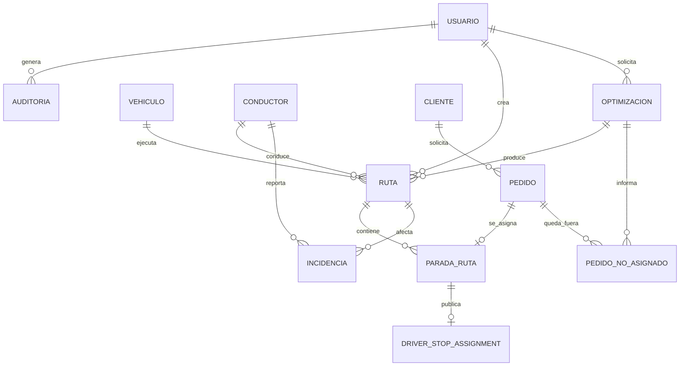
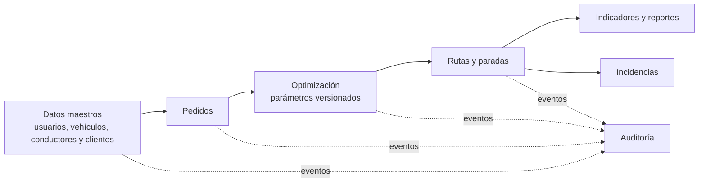

# Diseño e ingeniería de base de datos

- [Volver ->](<../../README.md>)

| Metadato | Valor |
|---|---|
| Proyecto | EcoLogística Lima |
| Versión | 1.4.0 |
| Fecha | 08/11/2026 |

## Modelo conceptual



El modelo conceptual es el diseño objetivo. Desde la versión 1.2.0 (ECL-95,
migración `0016_modelo_rutas`) existe el modelo de rutas y la incidencia gana
`ruta_id` opcional. La incidencia se sigue vinculando siempre al conductor que
la reporta y, de forma opcional, a una parada de su itinerario (ver modelo
lógico).

## Modelo lógico (3FN)

| Entidad | Atributos principales | Claves y propósito |
|---|---|---|
| usuario | usuario_id, email, password_hash, rol, estado, debe_cambiar_contrasena, contrasena_temporal_expira_en | PK usuario_id; email único; acceso. Los dos últimos atributos soportan el restablecimiento con contraseña temporal (ECL-77). |
| vehiculo | vehiculo_id, placa, tipo, capacidad_kg, capacidad_m3, rendimiento_km_l, factor_co2, anio, estado | PK; placa única; recursos de ruta. |
| conductor | conductor_id, usuario_id, dni, licencia, experiencia_anios, telefono, disponible_desde/hasta, punto_partida | PK; FK usuario; datos mínimos del conductor. |
| cliente | cliente_id, nombre, horario_preferido, referencia, restriccion_acceso | PK; preferencias de entrega. |
| pedido | pedido_id, cliente_id, direccion, ubicacion, peso_kg, volumen_m3, ventana_inicio/fin, prioridad, tipo_producto, estado | PK; FK cliente; ubicación PostGIS. |
| optimizacion | optimizacion_id, solicitada_por, fecha_operacion, estado, solicitada_en, finalizada_en, duracion_s, parametros_version, simulado, error, secuencial_(distancia_km, co2_kg, combustible_l, costo_soles), cumplimiento_ventanas_pct, instantanea | PK; FK usuario; ejecución reproducible: COMPLETADA exige `parametros_version`, solo FALLIDA tiene `error`, solo los estados finales tienen `finalizada_en`; `instantanea` guarda flota, pedidos, depósito y matriz usados. |
| ruta | ruta_id, optimizacion_id, fecha_operacion, vehiculo_id, conductor_id, motivo_sin_conductor, estado, salida, regreso, tiempo_min, peso_kg, volumen_m3, distancia_km, co2_kg, combustible_l, costo_soles, secuencial_(distancia_km, co2_kg, combustible_l, costo_soles), trazado, descansos, cerrada_en | PK; FKs; una ruta por vehículo y por conductor en cada optimización. `fecha_operacion` + `conductor_id` es la jornada del conductor. Sin conductor exige `motivo_sin_conductor` (ECL-79). `secuencial_*` es la práctica manual sobre los mismos pedidos y vehículo de la ruta; el Operador la cierra (CERRADA, `cerrada_en`) solo con todas las paradas terminales (ECL-119). |
| parada_ruta | parada_id, ruta_id, optimizacion_id, pedido_id, secuencia, eta, estado, atendida_en | PK; FK compuesta a (ruta, optimización); un pedido una sola vez por optimización; secuencia única por ruta. |
| pedido_no_asignado | optimizacion_id, pedido_id, motivo | PK compuesta; motivo de RN-009 (incluye `JORNADA_INVIABLE`, decisión 5 de la BDD de US-006). |
| driver_stop_assignment | stop_id, owner_id, position, pedido_id, status, assigned_at, parada_ruta_id | PK; itinerario publicado al conductor. Desde 1.2.0, `parada_ruta_id` opcional y único da a la asignación su ruta y jornada (ECL-82). |
| incidencia | incidencia_id, conductor_id, parada_id, ruta_id, operation_id, tipo, severidad, ubicacion, ocurrida_en, registrada_en, observacion, estado | PK; FK conductor (quien la reporta, siempre); FK opcional a la parada asignada al conductor; (conductor_id, operation_id) único para la idempotencia de la cola offline. Estado inicial PENDIENTE_VALIDACION (ECL-73). |
| parametro_version | version_id, version, vigente_desde, vigente_hasta, creada_por, creada_en, nota | PK; `version` única (la que guarda `optimizacion.parametros_version`); una sola versión abierta; una versión nueva cierra la anterior y nada se borra (EN-008). |
| parametro | parametro_id, version_id, codigo, valor, unidad, fuente | PK; FK versión; un código por versión; unidad fija por código; valor > 0; fuente obligatoria (RNF-011). La vigencia se registra en `parametro_version`. |
| auditoria | auditoria_id, usuario_id, entidad, entidad_id, accion, creado_en, detalle | PK; FK usuario; trazabilidad. |

Las entidades no repetitivas se mantienen en 3FN: preferencias pertenecen a cliente, las paradas resuelven la relación ruta-pedido y los parámetros conservan su vigencia. Los DNI y teléfonos requieren acceso restringido y nunca se exportan sin autorización.

**Incidencia y ruta (ECL-73, ECL-95).** En la versión 1.1.0 el modelo de rutas
no existía y la incidencia no tenía `ruta_id`. El conductor reportante
sustituye a `reportada_por`, y `parada_id` apunta a la asignación de parada del
conductor (`driver_stop_assignment`, la tabla que sostiene su itinerario).

Desde la versión 1.2.0 la incidencia tiene `ruta_id` **nullable**. Las
incidencias anteriores quedan con `null`. `parada_id` sigue apuntando a la
asignación, que ahora puede enlazar su `parada_ruta`: así ECL-82 obtiene la
jornada (`ruta.fecha_operacion`) sin cambiar la clave de la incidencia.

Lo ratificado por Julio al aprobar la BDD de ECL-72 en el PR #63:

- **Vínculo con el conductor:** la incidencia se vincula **siempre** al
  conductor que la reporta.
- **Incidencia sin ruta:** sin parada se permite una incidencia sin ruta.
- **Cuando exista el modelo de rutas:** una migración agregará `ruta_id`
  **nullable** (derivado de la parada cuando la haya). Cumplido en 1.2.0 con
  `0016_modelo_rutas`; el vínculo con `parada_ruta` se hace mediante la
  asignación (`driver_stop_assignment.parada_ruta_id`).

Los catálogos de tipo y severidad son los de esa BDD.

## Modelo físico (PostgreSQL/PostGIS)

```sql
CREATE EXTENSION IF NOT EXISTS pgcrypto;
CREATE EXTENSION IF NOT EXISTS postgis;

CREATE TABLE usuario (
  usuario_id UUID PRIMARY KEY DEFAULT gen_random_uuid(),
  email VARCHAR(255) NOT NULL UNIQUE,
  password_hash VARCHAR(255) NOT NULL,
  rol VARCHAR(20) NOT NULL CHECK (rol IN ('ADMINISTRADOR','OPERADOR','CONDUCTOR','ANALISTA','AUDITOR')),
  estado VARCHAR(15) NOT NULL DEFAULT 'ACTIVO' CHECK (estado IN ('ACTIVO','BLOQUEADO','INACTIVO')),
  creado_en TIMESTAMPTZ NOT NULL DEFAULT CURRENT_TIMESTAMP,
  -- ECL-77: restablecimiento con contraseña temporal y cambio obligatorio.
  debe_cambiar_contrasena BOOLEAN NOT NULL DEFAULT false,
  contrasena_temporal_expira_en TIMESTAMPTZ
);

CREATE TABLE vehiculo (
  vehiculo_id UUID PRIMARY KEY DEFAULT gen_random_uuid(),
  placa VARCHAR(10) NOT NULL UNIQUE,
  tipo VARCHAR(20) NOT NULL CHECK (tipo IN ('CAMIONETA','FURGON','MOTO')),
  capacidad_kg NUMERIC(10,2) NOT NULL CHECK (capacidad_kg > 0),
  capacidad_m3 NUMERIC(10,2) NOT NULL CHECK (capacidad_m3 > 0),
  rendimiento_km_l NUMERIC(10,3) NOT NULL CHECK (rendimiento_km_l > 0),
  factor_co2_kg_km NUMERIC(10,5) NOT NULL CHECK (factor_co2_kg_km >= 0),
  anio_fabricacion SMALLINT NOT NULL CHECK (anio_fabricacion BETWEEN 1980 AND 2100),
  estado VARCHAR(15) NOT NULL DEFAULT 'ACTIVO'
);

CREATE TABLE cliente (
  cliente_id UUID PRIMARY KEY DEFAULT gen_random_uuid(),
  nombre VARCHAR(160) NOT NULL,
  horario_preferido VARCHAR(120), referencia VARCHAR(255), restriccion_acceso VARCHAR(255)
);

CREATE TABLE pedido (
  pedido_id UUID PRIMARY KEY DEFAULT gen_random_uuid(),
  cliente_id UUID NOT NULL REFERENCES cliente(cliente_id),
  direccion VARCHAR(255) NOT NULL, referencia VARCHAR(255),
  ubicacion GEOGRAPHY(POINT,4326),
  peso_kg NUMERIC(10,2) NOT NULL CHECK (peso_kg > 0),
  volumen_m3 NUMERIC(10,3) NOT NULL CHECK (volumen_m3 > 0),
  ventana_inicio TIMESTAMPTZ NOT NULL, ventana_fin TIMESTAMPTZ NOT NULL,
  prioridad VARCHAR(12) NOT NULL CHECK (prioridad IN ('EXPRESS','ESTANDAR','ECONOMICO')),
  tipo_producto VARCHAR(20) NOT NULL, estado VARCHAR(15) NOT NULL DEFAULT 'PENDIENTE',
  CHECK (ventana_inicio < ventana_fin)
);

-- ECL-73: catálogos de la BDD aprobada de ECL-72 (app/core/incidencias.py).
-- Siempre vinculada al conductor; ruta_id nullable desde 0016 (ECL-95);
-- parada_id apunta a la asignación de parada del conductor
-- (driver_stop_assignment).
CREATE TABLE incidencia (
  incidencia_id UUID PRIMARY KEY DEFAULT gen_random_uuid(),
  conductor_id UUID NOT NULL REFERENCES conductor(conductor_id),
  parada_id UUID REFERENCES driver_stop_assignment(stop_id),
  operation_id UUID NOT NULL,
  tipo VARCHAR(20) NOT NULL CHECK (tipo IN ('TRAFICO','AVERIA','ACCIDENTE','CLIMA','SEGURIDAD','OTRO')),
  severidad VARCHAR(10) NOT NULL CHECK (severidad IN ('BAJA','MEDIA','ALTA')),
  ruta_id UUID REFERENCES ruta(ruta_id),
  ubicacion GEOGRAPHY(POINT,4326) NOT NULL,
  ocurrida_en TIMESTAMPTZ NOT NULL,
  registrada_en TIMESTAMPTZ NOT NULL DEFAULT CURRENT_TIMESTAMP,
  observacion VARCHAR(500) NOT NULL DEFAULT '' CHECK (char_length(observacion) <= 500),
  estado VARCHAR(25) NOT NULL DEFAULT 'PENDIENTE_VALIDACION'
    CHECK (estado IN ('PENDIENTE_VALIDACION','VALIDADA','DESCARTADA')),
  -- Idempotencia por conductor: el mismo UUID de otro conductor es independiente.
  CONSTRAINT uq_incidencia_conductor_operation UNIQUE (conductor_id, operation_id)
);

-- ECL-95 (ST-046): modelo de rutas; catálogos en app/core/rutas.py.
-- Métricas en DOUBLE PRECISION, sin redondeo intermedio (RNF-011).
CREATE TABLE optimizacion (
  optimizacion_id UUID PRIMARY KEY DEFAULT gen_random_uuid(),
  solicitada_por UUID NOT NULL REFERENCES usuario(usuario_id),
  fecha_operacion DATE NOT NULL,
  estado VARCHAR(12) NOT NULL DEFAULT 'EN_PROCESO'
    CHECK (estado IN ('EN_PROCESO','COMPLETADA','FALLIDA')),
  solicitada_en TIMESTAMPTZ NOT NULL DEFAULT CURRENT_TIMESTAMP,
  finalizada_en TIMESTAMPTZ, duracion_s DOUBLE PRECISION CHECK (duracion_s >= 0),
  parametros_version VARCHAR(40), simulado BOOLEAN NOT NULL DEFAULT false,
  error VARCHAR(300),
  secuencial_distancia_km DOUBLE PRECISION, secuencial_co2_kg DOUBLE PRECISION,
  secuencial_combustible_l DOUBLE PRECISION, secuencial_costo_soles DOUBLE PRECISION,
  cumplimiento_ventanas_pct DOUBLE PRECISION CHECK (cumplimiento_ventanas_pct BETWEEN 0 AND 100),
  instantanea JSONB NOT NULL DEFAULT '{}'::jsonb CHECK (jsonb_typeof(instantanea) = 'object'),
  CHECK ((estado = 'EN_PROCESO') = (finalizada_en IS NULL)),
  CHECK ((estado = 'FALLIDA') = (error IS NOT NULL)),
  CHECK (estado <> 'COMPLETADA' OR parametros_version IS NOT NULL)
);

CREATE TABLE ruta (
  ruta_id UUID PRIMARY KEY DEFAULT gen_random_uuid(),
  optimizacion_id UUID NOT NULL REFERENCES optimizacion(optimizacion_id),
  fecha_operacion DATE NOT NULL,
  vehiculo_id UUID NOT NULL REFERENCES vehiculo(vehiculo_id),
  conductor_id UUID REFERENCES conductor(conductor_id),
  motivo_sin_conductor VARCHAR(30) CHECK (motivo_sin_conductor IN ('SIN_CONDUCTOR_ELEGIBLE')),
  estado VARCHAR(12) NOT NULL DEFAULT 'PLANIFICADA'
    CHECK (estado IN ('PLANIFICADA','EN_CURSO','CERRADA')),
  salida TIMESTAMPTZ NOT NULL, regreso TIMESTAMPTZ NOT NULL CHECK (regreso >= salida),
  tiempo_min INTEGER NOT NULL, peso_kg NUMERIC(10,2) NOT NULL, volumen_m3 NUMERIC(10,3) NOT NULL,
  distancia_km DOUBLE PRECISION NOT NULL, co2_kg DOUBLE PRECISION NOT NULL,
  combustible_l DOUBLE PRECISION NOT NULL, costo_soles DOUBLE PRECISION NOT NULL,
  trazado GEOGRAPHY(LINESTRING,4326) NOT NULL,
  descansos JSONB NOT NULL DEFAULT '[]'::jsonb CHECK (jsonb_typeof(descansos) = 'array'),
  cerrada_en TIMESTAMPTZ,
  secuencial_distancia_km DOUBLE PRECISION, secuencial_co2_kg DOUBLE PRECISION,
  secuencial_combustible_l DOUBLE PRECISION, secuencial_costo_soles DOUBLE PRECISION,
  CHECK ((estado = 'CERRADA') = (cerrada_en IS NOT NULL)),
  CHECK ((conductor_id IS NULL) = (motivo_sin_conductor IS NOT NULL)),
  CONSTRAINT uq_ruta_vehiculo UNIQUE (optimizacion_id, vehiculo_id),
  CONSTRAINT uq_ruta_optimizacion UNIQUE (ruta_id, optimizacion_id)
);

CREATE TABLE parada_ruta (
  parada_id UUID PRIMARY KEY DEFAULT gen_random_uuid(),
  ruta_id UUID NOT NULL, optimizacion_id UUID NOT NULL,
  pedido_id UUID NOT NULL REFERENCES pedido(pedido_id),
  secuencia INTEGER NOT NULL CHECK (secuencia > 0),
  eta TIMESTAMPTZ NOT NULL,
  estado VARCHAR(12) NOT NULL DEFAULT 'PENDIENTE'
    CHECK (estado IN ('PENDIENTE','ATENDIDA','NO_ATENDIDA')),
  atendida_en TIMESTAMPTZ CHECK (estado <> 'ATENDIDA' OR atendida_en IS NOT NULL),
  FOREIGN KEY (ruta_id, optimizacion_id) REFERENCES ruta(ruta_id, optimizacion_id),
  CONSTRAINT uq_parada_ruta_secuencia UNIQUE (ruta_id, secuencia),
  CONSTRAINT uq_parada_ruta_pedido UNIQUE (optimizacion_id, pedido_id)
);

CREATE TABLE pedido_no_asignado (
  optimizacion_id UUID NOT NULL REFERENCES optimizacion(optimizacion_id),
  pedido_id UUID NOT NULL REFERENCES pedido(pedido_id),
  motivo VARCHAR(20) NOT NULL CHECK (motivo IN ('SIN_UBICACION','EXCEDE_CAPACIDAD',
    'VENTANA_INVIABLE','SIN_VEHICULO','JORNADA_INVIABLE')),
  PRIMARY KEY (optimizacion_id, pedido_id)
);

ALTER TABLE driver_stop_assignment
  ADD COLUMN parada_ruta_id UUID UNIQUE REFERENCES parada_ruta(parada_id);

-- EN-008 (ECL-26): parámetros versionados; catálogo en app/core/parametros.py.
CREATE TABLE parametro_version (
  version_id UUID PRIMARY KEY DEFAULT gen_random_uuid(),
  version VARCHAR(40) NOT NULL UNIQUE CHECK (version ~ '^[A-Z0-9][A-Z0-9._-]*$'),
  vigente_desde TIMESTAMPTZ NOT NULL,
  vigente_hasta TIMESTAMPTZ CHECK (vigente_hasta > vigente_desde),
  creada_por UUID NOT NULL REFERENCES usuario(usuario_id),
  creada_en TIMESTAMPTZ NOT NULL DEFAULT CURRENT_TIMESTAMP,
  nota VARCHAR(300)
);
CREATE UNIQUE INDEX uq_parametro_version_abierta ON parametro_version ((vigente_hasta IS NULL))
  WHERE vigente_hasta IS NULL;

CREATE TABLE parametro (
  parametro_id UUID PRIMARY KEY DEFAULT gen_random_uuid(),
  version_id UUID NOT NULL REFERENCES parametro_version(version_id),
  codigo VARCHAR(30) NOT NULL CHECK (codigo IN ('PRECIO_COMBUSTIBLE_GALON',
    'LITROS_POR_GALON','COSTO_MANTENIMIENTO_KM','CAPTURA_CO2_ARBOL_ANIO')),
  valor NUMERIC(18,9) NOT NULL CHECK (valor > 0),
  unidad VARCHAR(20) NOT NULL,  -- una sola unidad por código (PEN/gal, L/gal, PEN/km, kgCO2/arbol/anio)
  fuente VARCHAR(300) NOT NULL CHECK (fuente ~ '[^[:space:]]'),
  UNIQUE (version_id, codigo)
);

ALTER TABLE optimizacion ADD CONSTRAINT fk_optimizacion_parametros
  FOREIGN KEY (parametros_version) REFERENCES parametro_version(version);

CREATE INDEX ix_optimizacion_solicitada ON optimizacion (solicitada_en DESC, optimizacion_id);
CREATE INDEX ix_optimizacion_fecha_estado ON optimizacion (fecha_operacion, estado);
CREATE UNIQUE INDEX uq_ruta_conductor ON ruta (optimizacion_id, conductor_id)
  WHERE conductor_id IS NOT NULL;
CREATE INDEX ix_ruta_conductor_fecha ON ruta (conductor_id, fecha_operacion);
CREATE INDEX ix_ruta_fecha_estado ON ruta (fecha_operacion, estado);
CREATE INDEX ix_ruta_trazado ON ruta USING GIST (trazado);
CREATE INDEX ix_ruta_cerrada_en ON ruta (cerrada_en) WHERE estado = 'CERRADA';
CREATE INDEX ix_parada_ruta_pedido ON parada_ruta (pedido_id);
CREATE INDEX idx_pedido_pendiente_ventana ON pedido (estado, ventana_inicio);
CREATE INDEX ix_incidencia_estado_ocurrida ON incidencia (estado, ocurrida_en DESC);
CREATE INDEX idx_pedido_ubicacion ON pedido USING GIST (ubicacion);
CREATE INDEX idx_vehiculo_estado ON vehiculo (estado);
```

## Integridad y retención



Las operaciones de negocio usan transacciones. Las eliminaciones se sustituyen por estado inactivo; las rutas y optimizaciones mantienen los parámetros aplicados para reproducir resultados. Las copias de respaldo se cifran y se prueba su restauración en cada hito de liberación.

## Historial de control de cambios

| Versión | Fecha | Cambio | Motivo |
|---|---|---|---|
| 1.0.0 | 04/09/2026 | Línea base inicial. | Diseño de base de datos de la fase de inicio. |
| 1.1.0 | 25/10/2026 | Tabla `incidencia` tal como se implementó (sin `ruta_id`, con `conductor_id`, `parada_id` opcional, `operation_id` único, `registrada_en` y `observacion`) y columnas `debe_cambiar_contrasena` y `contrasena_temporal_expira_en` de `usuario`. | Coherencia documental con ECL-73 (migración `0013_incidencias`) y ECL-77 (migración `0012_password_reset`). |
| 1.1.0 | 25/10/2026 | Alineación con la BDD aprobada de ECL-72: incidencia vinculada siempre al conductor, `ruta_id` nullable cuando exista el modelo de rutas, unicidad `(conductor_id, operation_id)` y `observacion` NOT NULL con valor por defecto `''`. Mismo número de versión porque el documento aún no se había integrado en `main`. | Decisiones ratificadas por Julio en el [PR #63](https://github.com/JulioNaupariC/EcoLog-stica-Lima/pull/63). |
| 1.2.0 | 07/11/2026 | Modelo de rutas implementado: `optimizacion`, `ruta`, `parada_ruta` y `pedido_no_asignado` con sus restricciones e índices; `incidencia.ruta_id` nullable; `driver_stop_assignment.parada_ruta_id` para la jornada de ECL-82. Métricas sin redondeo intermedio. | ECL-95 (ST-046), migración `0016_modelo_rutas`, conforme a la BDD de US-006 v1.0.0 ratificada (decisiones 4, 5 y 7). |
| 1.3.0 | 07/11/2026 | Parámetros versionados: `parametro_version` (vigencia, una sola abierta) y `parametro` (código, valor, unidad fija y fuente); `optimizacion.parametros_version` referencia una versión existente. | EN-008 (ECL-26), migración `0017_parametros_versionados`, RNF-011 y decisión 8 de la BDD de US-006 (galón con factor documentado). |
| 1.4.0 | 08/11/2026 | Cierre de rutas: `ruta.secuencial_*` (referencia secuencial por ruta, nullable solo para rutas anteriores), índice parcial `ix_ruta_cerrada_en` (rutas CERRADA) y acción de auditoría `RUTA_CERRADA`. | ECL-119 (US-009), migración `0018_cierre_rutas`, conforme a la BDD de US-009 v1.0.0 ratificada. |

[← Volver al README principal](../../README.md)
