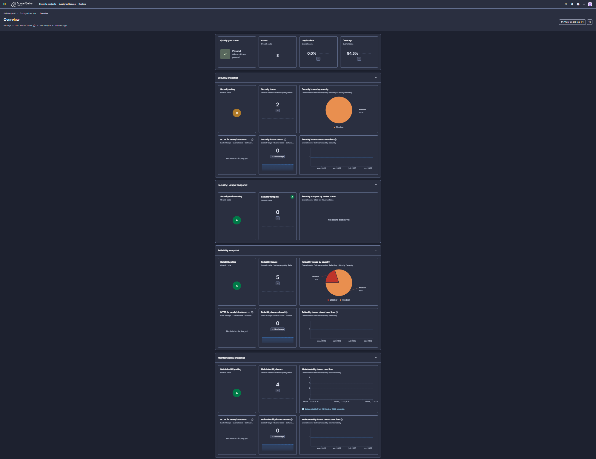
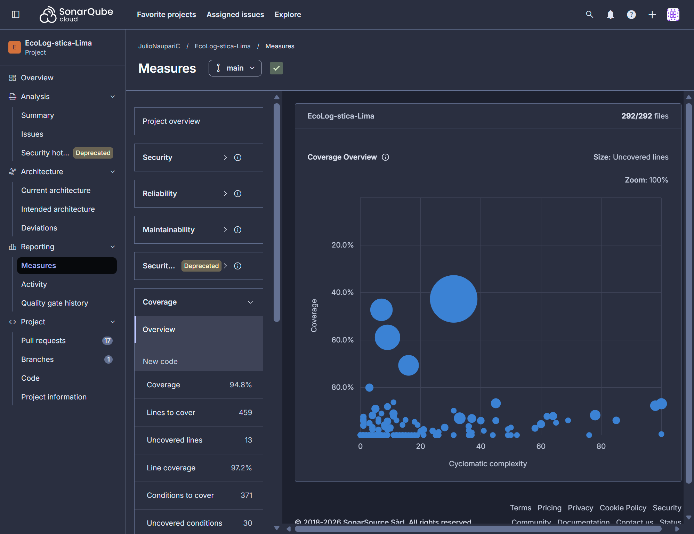

# Evidencias ECL-65 — Calidad de código con SonarCloud

Datos reales usados en la [Evaluación de Calidad de Código](<../../03 Calidad de código V_1_0_0.md>).
Los exportó Antony Munive desde la API pública de SonarCloud del proyecto
[JulioNaupariC_EcoLog-stica-Lima](https://sonarcloud.io/project/overview?id=JulioNaupariC_EcoLog-stica-Lima)
el 29/10/2026, tras el análisis de `main` en el commit `7fd891a`.

| Archivo | Endpoint de SonarCloud | Contenido |
|---|---|---|
| [sonarcloud-measures-main-7fd891a.json](sonarcloud-measures-main-7fd891a.json) | `api/measures/component` | Quality Gate (`alert_status=OK`), cobertura 94,5 %, duplicación 0,0 %, bugs 0, vulnerabilidades 2, code smells 6, hotspots 0, deuda de 57 min, calificaciones y 13 230 `ncloc` |
| [sonarcloud-issues-main-7fd891a.json](sonarcloud-issues-main-7fd891a.json) | `api/issues/search?resolved=false` | Los 8 issues abiertos, con regla, severidad, archivo, línea y esfuerzo (117 min) |
| [sonarcloud-analyses-main.json](sonarcloud-analyses-main.json) | `api/project_analyses/search` | Los 5 últimos análisis de `main`, con fecha y commit; el evaluado es el del 29/10/2026 a las 20:39 UTC |
| [sonarcloud-issues-main-6323f34.json](sonarcloud-issues-main-6323f34.json) | `api/issues/search?resolved=false`, re-análisis tras los PR #77 y #78 | 5 issues sin resolver: `pythonsecurity:S8703` y los 4 code smells del frontend (80 min) |

## Capturas de SonarCloud (rama `main`, 29/10/2026)

Tomadas por Antony Munive después del análisis de `7fd891a`.

| Captura | Qué muestra |
|---|---|
| [sonarcloud-overview-main.png](sonarcloud-overview-main.png) | Quality Gate «Passed — All conditions passed», 8 issues, duplicación 0,0 %, cobertura 94,5 %, calificaciones Seguridad C, Revisión de seguridad A, Fiabilidad A y Mantenibilidad A |
| [sonarcloud-measures-coverage-main.png](sonarcloud-measures-coverage-main.png) | Cobertura del código nuevo 94,8 %: 459 líneas por cubrir, 13 sin cubrir, 97,2 % de líneas, 371 condiciones con 30 sin cubrir; 292 archivos |
| [sonarcloud-overview-main-6323f34.png](sonarcloud-overview-main-6323f34.png) | Re-análisis tras #77 y #78: Quality Gate Passed, 6 issues (los 5 sin resolver más `S8414` aceptado), 1 issue de seguridad (Medium), 3 de mantenibilidad, 0 hotspots, cobertura 94,5 % |

Los JSON no contienen credenciales, correos ni rutas locales; se revisó antes de publicarlos.
Para reproducir, abrir los mismos endpoints con `component`/`project`
`JulioNaupariC_EcoLog-stica-Lima` con una sesión iniciada en SonarCloud.

[← Volver a la evaluación de calidad](<../../03 Calidad de código V_1_0_0.md>) ·
[Volver al índice del Sprint 3](../../README.md) ·
[Volver al README principal](../../../../../README.md)
