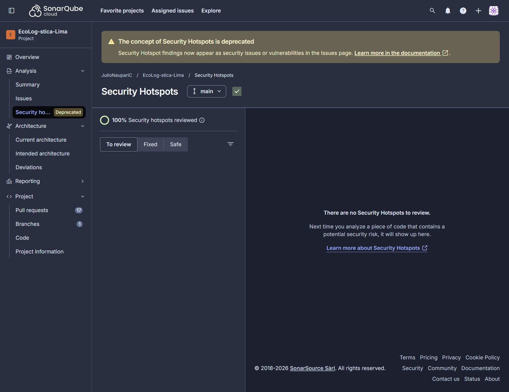
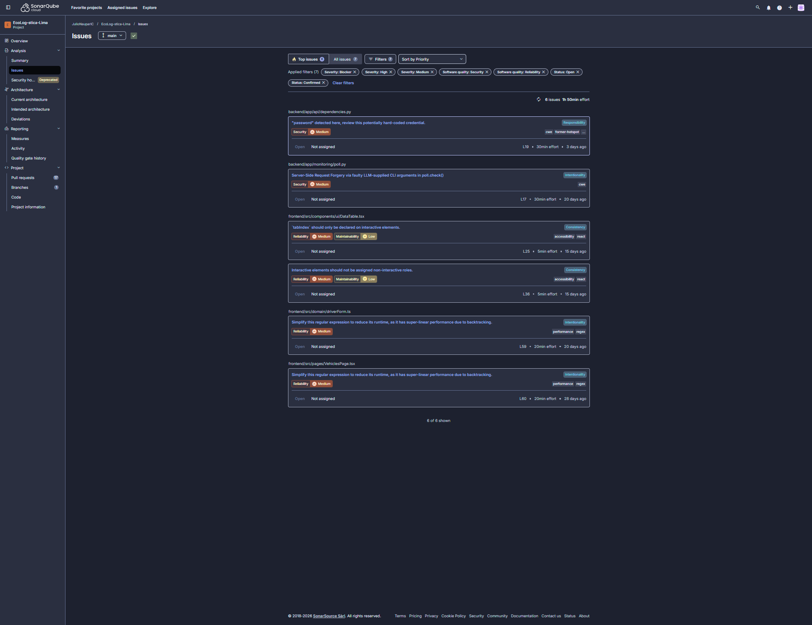

# Evidencias ECL-66 — Seguridad OWASP Top 10 2025

Resultados reales usados en el [Reporte de Seguridad OWASP](<../../04 OWASP V_1_0_0.md>).
Todos corresponden a la rama `main` en el commit `7fd891a` del 29/10/2026.

| Archivo | Origen | Contenido |
|---|---|---|
| [sonarcloud-issues-main-7fd891a.json](sonarcloud-issues-main-7fd891a.json) | API de SonarCloud `api/issues/search`, exportada por Antony Munive | 8 issues abiertos: 2 vulnerabilidades y 6 code smells |
| [sonarcloud-hotspots-main-7fd891a.json](sonarcloud-hotspots-main-7fd891a.json) | API de SonarCloud `api/hotspots/search` | 0 security hotspots abiertos |
| [pip-audit-requirements-7fd891a.json](pip-audit-requirements-7fd891a.json) | `pip-audit -r backend/requirements.lock --no-deps`, 15:42 (America/Lima) | 29 paquetes de producción, 0 vulnerabilidades |
| [pip-audit-requirements-dev-7fd891a.json](pip-audit-requirements-dev-7fd891a.json) | `pip-audit -r backend/requirements-dev.lock --no-deps` | 3 avisos en `certifi` y `setuptools` (corregidos en el PR #77) |
| [npm-audit-omit-dev-7fd891a.json](npm-audit-omit-dev-7fd891a.json) | `npm audit --omit=dev --json` en `frontend/` | 0 vulnerabilidades de producción |
| [npm-audit-all-7fd891a.json](npm-audit-all-7fd891a.json) | `npm audit --json` en `frontend/` | 4 avisos altos y 3 moderados en desarrollo (corregidos en el PR #77) |

## Capturas de SonarCloud (rama `main`, 29/10/2026)

Tomadas por Antony Munive después del análisis de `7fd891a` y de que Julio Naupari
registrara la aceptación justificada de `python:S8414`.

| Captura | Qué muestra |
|---|---|
| [sonarcloud-security-hotspots-main.png](sonarcloud-security-hotspots-main.png) | «100 % Security hotspots reviewed» y «There are no Security Hotspots to review» |
| [sonarcloud-issues-main.png](sonarcloud-issues-main.png) | 7 issues abiertos tras aceptar `S8414` (antes eran 8); con filtros de seguridad y fiabilidad se ven las 2 vulnerabilidades Medium (`dependencies.py:19` y `poll.py:17`) y los 4 code smells del frontend |

Los JSON no contienen credenciales, correos ni rutas locales; se revisó antes de publicarlos.
Para reproducir: ejecutar los mismos comandos desde la raíz del repositorio sobre el commit
indicado. Las cifras generales del proyecto (Quality Gate, cobertura, duplicación) están
en la evaluación de calidad de ECL-65.

[← Volver al reporte OWASP](<../../04 OWASP V_1_0_0.md>) ·
[Volver al índice del Sprint 3](../../README.md) ·
[Volver al README principal](../../../../../README.md)
