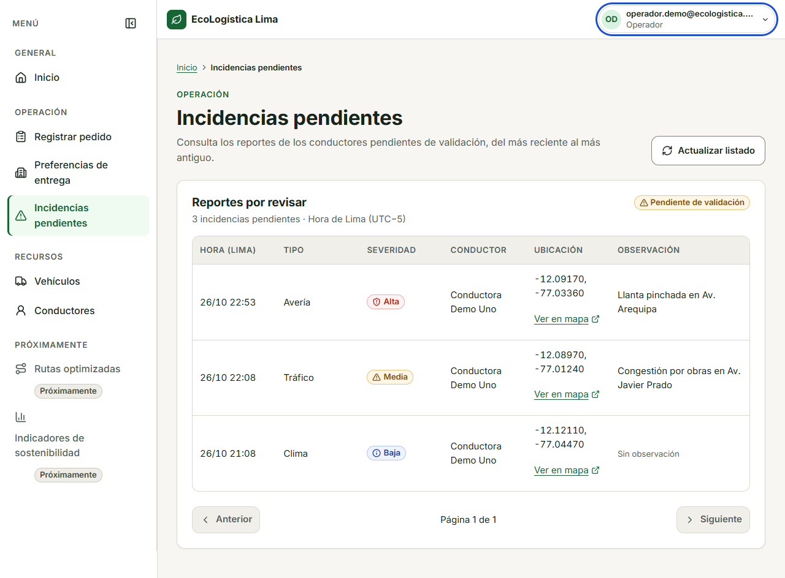

# ECL-75 — Evidencias de la vista de incidencias de Operación

Capturas realizadas el 26/10/2026 (America/Lima) en Chrome 156.0.8078.48,
con Docker Compose local y cuentas ficticias. No contienen contraseñas ni datos
personales reales. El [registro JSON](results.json) conserva el instante UTC,
dimensiones, resultados y origen real o simulado de cada comprobación.

## API real y datos de demostración

Estas cuatro imágenes muestran las tres incidencias creadas por el seed de
ECL-73. No se simularon las respuestas del listado en estas capturas.

| Ancho | Tema | Captura |
|---|---|---|
| 360 px | Claro | [Vista móvil clara](chrome-360-light.png) |
| 360 px | Oscuro | [Vista móvil oscura](chrome-360-dark.png) |
| 1280 px | Claro | [Vista de escritorio clara](chrome-1280-light.png) |
| 1280 px | Oscuro | [Vista de escritorio oscura](chrome-1280-dark.png) |

## Estados controlados mediante respuestas simuladas

El navegador interceptó exclusivamente el GET del listado para reproducir estos
estados. No se insertaron, borraron ni alteraron incidencias en la base.

| Estado | Captura | Observable |
|---|---|---|
| Sin pendientes | [Vacío](chrome-empty-1280.png) | Mensaje explícito y actualización disponible |
| Servicio no disponible | [HTTP 503](chrome-error-1280.png) | Error y botón Reintentar; recuperación comprobada |
| Acceso rechazado | [HTTP 403](chrome-forbidden-1280.png) | Explicación de roles autorizados |
| Espera superior a un segundo | [Carga lenta](chrome-loading-1280.png) | Esqueleto, anuncio de carga y actualización deshabilitada |
| Observación larga a 360 px | [Detalle y foco de teclado](chrome-observation-keyboard-360.png) | Texto completo abierto con Enter; sin desbordamiento horizontal |

La paginación se probó con 21 registros simulados: Siguiente por teclado,
Página 2 de 2 y regreso con Anterior. Las denegaciones de roles se verificaron
tanto en la interfaz como contra la API real.

## Límites y repetición

La comprobación automatizada de accesibilidad abarca únicamente esta página;
no acredita por sí sola WCAG 2.1 AA ni sustituye ECL-67. La compatibilidad de
otros navegadores y los flujos completos de ECL-76 se verifican por separado.

El script reproducible y los comandos están en la
[validación ST-042](<../../VALIDACION_ST042.md>). Para otra ejecución elegir un
directorio nuevo con `ECL75_OUTPUT`; conservar estas capturas sin sobrescribirlas.

[↑ Índice del Sprint 3](<../../../README.md>)

[← Volver al README principal](<../../../../../../README.md>)
